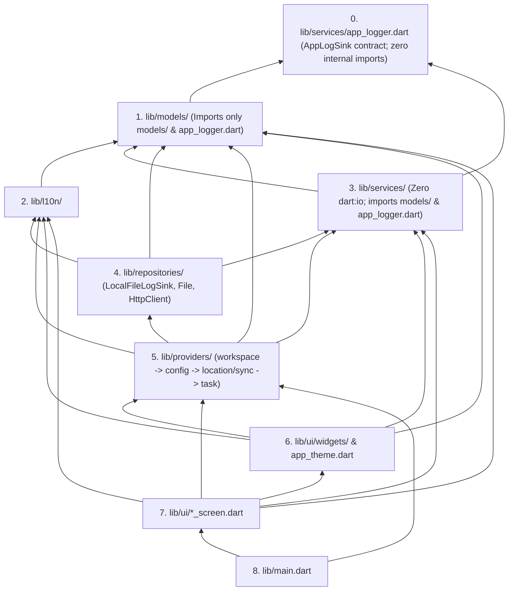

# TEP-001: Agent-Optimized Codebase Architecture, Acyclic Import DAG, and Sub-5s TDD Harness

## Part 1: Concept & Proposal

### 1.1 Summary
Restructure the TierTask Flutter codebase (`lib/` and `test/`), static verification tooling (`.agents/scripts/tiertask_dev.py`), and architectural governance rules (`AGENTS.md` and `ARCHITECTURE.md`) to maximize AI coding agent execution speed, context-window efficiency, deterministic symbol navigation, and collision-free parallel subagent execution. This proposal decomposes the 12 monolithic production files exceeding `1,000` lines (`1,003–3,291` lines) into cohesive leaf modules under a two-tier size budget (`300–650` lines target, `900` lines hard ceiling) while keeping cohesive `820–879` line files intact, eliminates all 3 circular import Strongly Connected Components (SCCs) across `lib/` using a single unified `AppLogger` (`AppLogSink`) API and canonical direct imports (zero `export` shims), introduces `test/providers/` and a zero-I/O leaf widget test harness (`pumpLeafWidget`) across `~41` focused test suites (avoiding 68-isolate startup overhead in `verify --full`), and guarantees `< 5s` incremental verification in `tiertask_dev.py verify --fast`.

### 1.2 Motivation
Empirical analysis of the TierTask repository identified four structural bottlenecks that degrade LLM tool round-trips, static dependency pruning, test execution speed, and parallel subagent scalability:

1. **`read_file` 800-Line Window vs. Multi-Thousand-Line Monoliths:**
   * The agent `read_file` tool returns at most $W = 800$ lines (or 46,080 bytes) per call, and `edit_file` requires an exact contiguous target block. For a file of length $L$, reading the full file requires $\lceil L / 800 \rceil$ sequential tool calls.
   * Currently, **12 production files exceed 1,000 lines**: `lib/services/tdf_service.dart` (`3,291L`, 5 reads), `lib/models/task_board.dart` (`2,852L`, 4 reads), `lib/services/tdf_importer.dart` (`2,431L`, 4 reads), `lib/ui/settings_screen.dart` (`1,904L`, 3 reads), `lib/ui/home_screen.dart` (`1,722L`, 3 reads), `lib/models/task_board_sync.dart` (`1,654L`, 3 reads), `lib/ui/widgets/task_editor_sections.dart` (`1,430L`, 2 reads), `lib/providers/task_providers.dart` (`1,348L`, 2 reads), `lib/ui/widgets/workspace_dialog.dart` (`1,238L`, 2 reads), `lib/ui/widgets/tier_task_pill.dart` (`1,148L`, 2 reads), `lib/ui/widgets/task_editor_conditions_section.dart` (`1,086L`, 2 reads), and `lib/repositories/local_file_repository.dart` (`1,003L`, 2 reads). In addition, `test/ui/home_screen_test.dart` (`1,486L`) and `test/ui/widgets/tier_task_pill_test.dart` (`1,292L`) exceed 1,200 lines.
   * Because `AGENTS.md` Section 1 defines `~500 lines` as a soft target with an unenforced escape clause (`"if a clean split is not possible, keeping the larger file is acceptable"`), agents append new logic to existing monoliths rather than extracting leaf files.

2. **Intra-Class Alphabetical Method Scattering (`AGENTS.md` Section 2.5):**
   * `AGENTS.md` Section 2.5 mandates sorting all `_private` methods inside a class alphabetically by identifier. While deterministic inside focused classes, applying this rule inside 2,000–3,200 line classes scatters cohesive functional pipelines across thousands of lines by verb prefix (`_add*`, `_apply*`, `_check*`, `_escape*`, `_find*`, `_is*`, `_open*`, `_parse*`, `_process*`, `_require*`, `_scan*`, `_validate*`, `_write*`):
     * In `TdfService` (`2,695L`, 71 `_private` methods), lexical scanning spans 6 disconnected ranges from `_findLineSpan` (`L1007`) to `_scanBareWordToken` (`L2220`) and `_validatePostQuoteDelimiter` (`L2537`), while directive appliers (`_applyTaskDirective` at `L680`) are separated by 700–1,400 lines from the `_parse*` (`L1346–1671`) and `_require*` (`L1896–2218`) validators they invoke.
     * In `TaskBoard` (`2,789L`, 52 `_private` methods), dynamic 6-tier evaluation, condition inheritance, dependency cycle checks, queue ordering, and task/label mutations are interleaved from `L1376` to `L2812`.
   * Consequently, modifying a single subsystem requires 3–5 separate `read_file` calls and 2–4 non-adjacent `edit_file` calls, and concurrent subagents editing different subsystems in the same class collide on adjacent alphabetical regions.

3. **Circular Import SCCs and Upward Layer Violations:**
   * Tarjan Strongly Connected Component (SCC) analysis across the 45 files in `lib/` revealed **3 import cycles** and **5 upward cross-layer dependencies**:
     * **SCC 1 (6-file cross-layer cycle across `models <-> services <-> repositories`):** `lib/services/app_logger.dart` imports `lib/repositories/local_file_repository.dart` (for static synchronous log file helpers) and `dart:io show Platform`; `local_file_repository.dart` imports `lib/services/tdf_service.dart` and `app_logger.dart`; `tdf_service.dart` imports `lib/models/task_board.dart`, `lib/services/tdf_importer.dart`, and `app_logger.dart`; `tdf_importer.dart` imports `tdf_service.dart`, `tdf_id_migration.dart`, and `task_board.dart`; and `task_board.dart` imports `app_logger.dart`. Additionally, `lib/models/task_board_sync.dart` and `lib/models/tdf_payload_comparison.dart` import `lib/services/tdf_service.dart` for `TdfException` and `TdfErrorKind`.
     * **SCC 2 (2-file cycle in `providers/`):** `lib/providers/task_providers.dart` $\leftrightarrow$ `lib/providers/workspace_providers.dart` (`workspace_providers.dart` imports `task_providers.dart` solely for `settingsRepositoryProvider`).
     * **SCC 3 (3-file cycle in `ui/`):** `lib/ui/edit_task_screen.dart` $\leftrightarrow$ `lib/ui/widgets/quick_add_bar.dart` $\leftrightarrow$ `lib/ui/widgets/task_editor_sections.dart` (`quick_add_bar.dart` defines `enum QuickAddMode` and imports `edit_task_screen.dart` to call `openEditTaskScreen`).
     * **Upward `providers -> ui` Dependency:** `lib/providers/task_providers.dart` imports `lib/ui/app_theme.dart` for `AppThemeNotifier` and `appThemeProvider`.

4. **Test Suite Coupling, `HttpOverrides.global` Poisoning, and Provider Test Gaps:**
   * `run_command` backgrounds any command exceeding 10 seconds (`WaitMsBeforeAsync: 10000`).
   * Most UI test suites in `test/ui/` import `lib/main.dart` and `test/ui/test_helpers.dart` (`FakeLocalFileRepository` + `FakeWebDavRepository`) and pump the full `TierTaskApp`, booting `HomeScreen`, `TaskNotifier.build()`, and `TdfService.parse()` even when testing isolated leaf widgets (`AppLogo`, `ClearableTextField`, `TierPageIndicator`, `WipeTdfDialog`, `TierTaskPill`).
   * `TestWidgetsFlutterBinding.ensureInitialized()` installs Flutter's `_MockHttpOverrides` on `HttpOverrides.global`, causing any `HttpClient()` call to return HTTP `400` immediately. Currently, `test/repositories/storage_and_providers_test.dart` and `test/services/app_logger_test.dart` bind loopback `HttpServer` instances without resetting `HttpOverrides.global = null`.
   * `test/providers/` does not exist at all; provider tests are mixed into `test/repositories/storage_and_providers_test.dart`, `sync_merge_test.dart`, and `local_directory_migration_test.dart`.

### 1.3 Goals & Non-Goals
* **Goals:**
  1. **Pragmatic File Size Budget (`P-FILE-SIZE`):** Decompose the 12 monolithic production files (`> 1,000L`) and oversized UI test files (`> 1,000L`) so new/split modules stay within a **300–650 line target**, with a **750-line pre-edit split trigger** for feature additions and a **900-line hard ceiling** enforced by `tiertask_dev.py` (keeping cohesive `820–879L` files intact without unnecessary micro-splits).
  2. **Cohesive Subsystem Locality (`P-CLASS-COHESION`):** Bound each class to a single responsibility with at most **15–18 `_private` helper methods** so callers and their alphabetically sorted `_private` callees reside within a contiguous `< 500`-line span, without fragmenting a single domain operation across more than 2–3 files.
  3. **Strict Acyclic Layer DAG with a Single `AppLogger` API (`P-ACYCLIC-DAG`):** Reduce circular import SCCs in `lib/` from `3` to **`0`** by decoupling `AppLogger` (`lib/services/app_logger.dart`) via `AppLogSink` at the base of the DAG (so every layer including `lib/models/` calls `AppLogger` directly without a second `DomainLogger` API), moving `TdfErrorKind`/`TdfException` to `lib/models/tdf_error.dart`, and using direct canonical imports with **zero `export` shims**.
  4. **Cohesive Test Mapping & Layer Isolation (`P-TEST-MIRROR`):** Create `test/providers/` for the 5 provider modules, isolate loopback `HttpServer` tests in `test/repositories/` with `HttpOverrides.global = null`, test leaf UI widgets via a zero-I/O `pumpLeafWidget` harness, and keep total test suites around **`41` files** so `verify --full` avoids per-file isolate bloat while `verify --fast` completes in **`2.0–4.5 seconds`**.
  5. **Collision-Free Parallel Subagent Execution (`P-SUBAGENT-ISOLATION`):** Establish orthogonal file boundaries and explicit subagent file-ownership and verification rules in `AGENTS.md`.
* **Non-Goals:**
  1. No changes to the TierTask Data Format (`TDF`) syntax, dynamic 6-tier derivation semantics, three-way merge algorithm, or `TDF_SPEC.md` normative rules.
  2. No changes to user-facing UI appearance, gestures, keyboard shortcuts, or English/German (`app_en.arb`, `app_de.arb`) translations.
  3. No changes to binary workspace (`TTW\x01`) or sync baseline (`TTS\x01`/`TTS\x02`) wire formats.
  4. No introduction of third-party packages, code-generation frameworks (`build_runner`, `freezed`), Dart `part`/`part of` directives, barrel `export` shims, or artificial 1:1 micro-test files for internal parser AST builders.

### 1.4 Description
`TEP-001` preserves TierTask's 6 top-level architectural layers (`lib/l10n/`, `lib/models/`, `lib/services/`, `lib/repositories/`, `lib/providers/`, `lib/ui/`) while decomposing the 12 `1,000+` line monoliths into `55` focused production files connected via explicit relative `import` statements:

* **Facade Preservation & Cohesive Subsystem Engines:**
  * Public domain and service entrypoints (`TaskBoard`, `TaskBoardSync`, `TdfService`, `TdfImporter`, `LocalFileRepository`) remain at their canonical file paths and retain their public method signatures.
  * Internal subsystems of the `1,000+` line monoliths are extracted into stateless helper classes with private `const Class._()` constructors:
    * `TaskBoard` (`2,852L`) $\rightarrow$ `task_board.dart`, `task_board_evaluator.dart`, `task_board_mutator.dart`, `task_board_queue_mutator.dart` (4 files).
    * `TaskBoardSync` (`1,654L`) $\rightarrow$ `task_board_sync.dart`, `task_board_reconciler.dart`, `workspace_sync_state.dart` (3 files).
    * `TdfService` (`3,291L`) $\rightarrow$ `lib/models/tdf_error.dart` + `tdf_service.dart`, `tdf_scanner.dart`, `tdf_parser.dart`, `tdf_directive_parser.dart`, `tdf_serializer.dart` (5 service files + 1 model error file).
    * `TdfImporter` (`2,431L`) $\rightarrow$ `tdf_importer.dart`, `tdf_historical_parser.dart`, `tdf_historical_serializer.dart` (3 files).
    * `LocalFileRepository` (`1,003L`) $\rightarrow$ `local_file_repository.dart`, `local_file_operations.dart` (2 files).
* **Single Unified `AppLogger` at the DAG Base:**
  * `lib/services/app_logger.dart` replaces `import 'dart:io' show Platform;` with `defaultTargetPlatform.name` (`package:flutter/foundation.dart`) and replaces its `LocalFileRepository` import with `abstract interface class AppLogSink` (implemented by `const LocalFileLogSink()` in `lib/repositories/local_file_repository.dart`).
  * Because `app_logger.dart` now has zero dependencies on `models/`, `repositories/`, `providers/`, or `ui/`, it sits at rank 0 of the DAG and is imported directly by all layers (`models`, `services`, `repositories`, `providers`, `ui`) per `AGENTS.md` Section 6 without creating any cycle.
* **UI & Provider Granularity:**
  * `lib/providers/task_providers.dart` (`1,348L`) is split into `workspace_providers.dart`, `config_providers.dart`, `location_providers.dart`, `sync_providers.dart`, and `task_providers.dart`, with `AppThemeNotifier` / `appThemeProvider` moved to `lib/ui/app_theme.dart`.
  * The 6 `1,000+` line UI files (`settings_screen.dart`, `home_screen.dart`, `task_editor_sections.dart`, `workspace_dialog.dart`, `tier_task_pill.dart`, `task_editor_conditions_section.dart`) extract cohesive `StatelessWidget` and `ChangeNotifier` leaf components into `lib/ui/widgets/`.

### 1.5 Alternatives

| Alternative | Evaluation & Rejection Rationale |
| :--- | :--- |
| **1. Dart `part` / `part of` Library Stitching** | **Rejected.** Splitting large files via `part` / `part of` merges all physical files into a single shared `_private` namespace, hiding cross-file symbol dependencies from `read_file` (since `part of` files contain no `import` headers), violating `AGENTS.md` Section 2.3 (`P-DIRECTIVES-ORDER`), and collapsing the entire library into a single node in `tiertask_dev.py deps` and the Dart analyzer. |
| **2. Extreme Micro-Fragmentation (`67` `lib/` Files + `68` `test/` Files)** | **Rejected.** Splitting `TdfService` into 8 files, `TdfImporter` into 5 files, and splitting cohesive `820–879L` files (`task_item.dart`, `tdf_metadata.dart`, `edit_task_screen.dart`, `quick_add_bar.dart`, `app_theme.dart`) forces an agent to read and edit 5–6 files to add a single TDF directive and doubles `flutter test` isolate startup overhead across 68 test files during `verify --full`. |
| **3. Dual Logging APIs (`DomainLogger` in `models/` + `AppLogger` in `services/`)** | **Rejected.** Introducing a separate `DomainLogger` callback class in `lib/models/domain_log.dart` creates two competing logging APIs across directories. Decoupling `AppLogger` via `AppLogSink` makes `app_logger.dart` a zero-dependency leaf so every layer can call `AppLogger` directly. |
| **4. Leaving `export` Re-Export Shims in Split Files** | **Rejected.** Adding `export '...';` directives in `tdf_service.dart` or `task_board_sync.dart` violates `AGENTS.md` Section 2 ("Keep barrel files minimal or omit them") and creates duplicate import paths that obscure `tiertask_dev.py deps`. Updating consuming `import` statements directly keeps the import graph canonical. |

## Part 2: Technical Design & Code Changes

### 2.1 Architecture & Affected Modules

#### 2.1.1 Target Production Directory Tree (`lib/` — 55 Hand-Written Leaf Files, All $\le 880$ Lines)
```text
lib/
├── main.dart                                             (107L)
├── l10n/
│   ├── app_de.arb
│   ├── app_en.arb
│   └── tier_localization_extension.dart                  (57L)
├── models/
│   ├── app_workspace.dart                                (537L)
│   ├── location_state.dart                               (212L)
│   ├── task_board.dart                                   (~565L, split from 2,852L)
│   ├── task_board_evaluator.dart                         (~575L, new: 6-tier derivation & condition eval)
│   ├── task_board_mutator.dart                           (~620L, new: task/label/subtask CRUD & recurrence)
│   ├── task_board_queue_mutator.dart                     (~555L, new: schedule, block, downgrade, restore, queue)
│   ├── task_board_reconciler.dart                        (~545L, new: 3-way entity reconciliation & conflicts)
│   ├── task_board_sync.dart                              (~520L, split from 1,654L: merge, queue, deleted, cycles)
│   ├── task_item.dart                                    (872L, kept intact)
│   ├── task_tier.dart                                    (~65L, adds QuickAddMode from quick_add_bar.dart)
│   ├── tdf_error.dart                                    (~145L, new: TdfErrorKind, TdfException)
│   ├── tdf_metadata.dart                                 (879L, kept intact)
│   ├── tdf_payload_comparison.dart                       (719L)
│   ├── tdf_sync_metadata.dart                            (475L)
│   ├── tdf_timezone.dart                                 (491L)
│   ├── webdav_config.dart                                (510L)
│   └── workspace_sync_state.dart                         (~285L, new: WorkspaceSyncState TTS\x01/v2 codec)
├── services/
│   ├── app_logger.dart                                   (~440L, DAG rank 0 leaf decoupled via AppLogSink)
│   ├── base64_service.dart                               (331L)
│   ├── tdf_directive_parser.dart                         (~640L, new: directive appliers & argument validators)
│   ├── tdf_historical_parser.dart                        (~650L, new: 0.2.0-0.4.0 AST, scanner & block parser)
│   ├── tdf_historical_serializer.dart                    (~410L, new: historical & 0.5.0 serializer & ID rewrite)
│   ├── tdf_id_migration.dart                             (317L)
│   ├── tdf_importer.dart                                 (~555L, split from 2,431L)
│   ├── tdf_parser.dart                                   (~620L, new: 0.5.1 block builders & block line parser)
│   ├── tdf_scanner.dart                                  (~475L, new: single-pass lexical scanner & literals)
│   ├── tdf_serializer.dart                               (~310L, new: canonical 0.5.1 serializer)
│   └── tdf_service.dart                                  (~485L, split from 3,291L)
├── repositories/
│   ├── app_version_repository.dart                       (189L)
│   ├── link_launcher_repository.dart                     (101L)
│   ├── local_file_operations.dart                        (~515L, new: path validation, safe move, log I/O)
│   ├── local_file_repository.dart                        (~525L, split from 1,003L; includes LocalFileLogSink)
│   ├── location_repository.dart                          (527L)
│   ├── settings_repository.dart                          (478L)
│   └── webdav_repository.dart                            (320L)
├── providers/
│   ├── config_providers.dart                             (~340L, new: WebDavConfigNotifier, locale/theme/repo providers)
│   ├── location_providers.dart                           (171L)
│   ├── sync_providers.dart                               (~390L, new: SyncStateNotifier & 2-stage sync pipeline)
│   ├── task_providers.dart                               (~460L, split from 1,348L: TaskNotifier mutations)
│   └── workspace_providers.dart                          (~195L, adds settingsRepositoryProvider)
└── ui/
    ├── app_theme.dart                                    (~855L, kept intact; adds AppThemeNotifier)
    ├── edit_labels_screen.dart                           (535L)
    ├── edit_task_screen.dart                             (868L, kept intact)
    ├── home_screen.dart                                  (~540L, split from 1,722L)
    ├── settings_screen.dart                              (~540L, split from 1,904L)
    └── widgets/
        ├── app_logo.dart                                 (147L)
        ├── clearable_text_field.dart                     (301L)
        ├── condition_editor_controller.dart              (~350L, new: extracted from task_editor_conditions_section.dart)
        ├── home_drawer.dart                              (~420L, new: extracted from home_screen.dart)
        ├── home_tier_pane.dart                           (~300L, new: extracted from home_screen.dart)
        ├── home_top_bar.dart                             (~310L, new: extracted from home_screen.dart)
        ├── local_tdf_file_dialogs.dart                   (432L)
        ├── location_status_dialog.dart                   (265L)
        ├── log_viewer_dialog.dart                        (284L)
        ├── quick_add_bar.dart                            (800L, kept intact; QuickAddMode moved to task_tier.dart)
        ├── settings_local_storage_section.dart           (~260L, new: extracted from settings_screen.dart)
        ├── settings_preference_cards.dart                (~460L, new: extracted from settings_screen.dart)
        ├── settings_webdav_storage_section.dart          (~340L, new: extracted from settings_screen.dart)
        ├── task_editor_conditions_section.dart           (~640L, split from 1,086L)
        ├── task_editor_links_section.dart                (298L)
        ├── task_editor_scheduling_card.dart              (~450L, new: extracted from task_editor_sections.dart)
        ├── task_editor_sections.dart                     (~520L, split from 1,430L)
        ├── task_editor_subtasks_and_blockers.dart        (~490L, new: extracted from task_editor_sections.dart)
        ├── tier_page_indicator.dart                      (487L)
        ├── tier_task_pill.dart                           (~540L, split from 1,148L)
        ├── tier_task_subtasks_section.dart               (~580L, new: extracted from tier_task_pill.dart)
        ├── wipe_tdf_dialog.dart                          (300L)
        ├── workspace_dialog.dart                         (~620L, split from 1,238L)
        └── workspace_row_card.dart                       (~590L, new: extracted from workspace_dialog.dart)
```

#### 2.1.2 File-by-File Decomposition Map (`12 Monoliths > 1,000L -> Cohesive Leaf Modules`)

| Current Monolith (Lines) | Target Leaf File | Est. Lines | Primary Classes & Assigned Responsibilities |
| :--- | :--- | ---: | :--- |
| `lib/services/tdf_service.dart` (`3,291L`) | `lib/models/tdf_error.dart` | `~145L` | `TdfErrorKind` (29 normative variants), `TdfException` (`@immutable`), `maxTdfBlocksPerDoc`. Imported directly by `models/`, `services/`, and `test/`. |
| | `lib/services/tdf_service.dart` | `~485L` | `TdfService` facade: `static const` bounds, `importDocument`, `parse`, `serialize`, `_parseInternal`, `_validateByteLimit`, `_validateDependencyCycles`, `_checkTaskCycle`, `_validateLabelReferences`, `_validateQueueMembership`, `_synthesizeLegacy050Queue`. |
| | `lib/services/tdf_scanner.dart` | `~475L` | `TdfScanner`, `TdfLineSpan`, `TdfScannedToken`, `TdfTokenKind`: `findLineSpan`, `scanLineTokens`, `isValidIdentifier`, `isValidCanonicalUnsignedInt`, `isValidDecimalLiteral`, quote/escape/comment scanners. |
| | `lib/services/tdf_parser.dart` | `~620L` | `TdfParserState`, `TdfBlockBuilder` sealed hierarchy (`TdfTaskBuilder`, `TdfLabelBuilder`, `TdfQueueBlockBuilder`, `TdfDeletedBlockBuilder`, `TdfConditionBlockBuilder`, `TdfSubtasksBuilder`), and `TdfBlockParser` (`processLogicalLine`, `closeCurrentBlock`, `_openBlock`, `_processInitialStatement`). |
| | `lib/services/tdf_directive_parser.dart` | `~640L` | `TdfDirectiveParser` (`applyTaskDirective`, `applyLabelDirective`, `applyQueueDirective`, `applyDeletedDirective`, `applyConditionBlockDirective`, `applySubtasksDirective`) and argument/condition rule validators (`requireTimestampArgs`, `requireRepeatRuleArgs`, `parseInlineConditionArgs`). |
| | `lib/services/tdf_serializer.dart` | `~310L` | `TdfSerializer`: `serialize`, `escapeQuotedString`, `_orderConditionsForSerialization`, `_validateCanonicalOutputBounds`, `_writeQueueBlock`, `_writeDeletedBlock`, `_writeLabelBlock`, `_writeTaskBlock`. |
| `lib/models/task_board.dart` (`2,852L`) | `lib/models/task_board.dart` | `~565L` | `TaskBoard` immutable state, constructors (`TaskBoard`, `TaskBoard.empty`, `TaskBoard.evaluate`), lookup queries, delegating mutation facade methods, and `_NormalizedTierSlices`. |
| | `lib/models/task_board_evaluator.dart` | `~575L` | `TaskBoardEvaluator`: `evaluate`, `evaluateForContext`, `applyAutoPull`, `pruneCompletedTasks`, `cleanupExpiredDeletions`, `isReachableInDependencyGraph`, `resolveEffectiveTimeZone`, and condition/tier evaluation helpers. |
| | `lib/models/task_board_mutator.dart` | `~620L` | `TaskBoardMutator`: `addTask`, `updateTask`, `completeTask`, `toggleSubtask`, `deleteTask`, `addLabel`, `updateLabel`, `deleteLabel`, `_rescheduleRecurringTask`, `_armDependenciesForTask`, `_rearmDependencies`. |
| | `lib/models/task_board_queue_mutator.dart` | `~555L` | `TaskBoardQueueMutator`: `scheduleTask`, `blockTask`, `downgradeTask`, `restoreTask`, `moveTaskInQueue`, `appendTaskToQueue`, `removeTaskFromQueue`, `updateQueueForEditedTask`, `_downgradeFromFocus`, `_downgradeToPlanned`, `_downgradeToSomeday`. |
| `lib/services/tdf_importer.dart` (`2,431L`) | `lib/services/tdf_importer.dart` | `~555L` | `TdfImporter`, `TdfImportResult`: `importDocument`, `migrate020To030`, `migrate030To040`, `migrate040To050`, `migrate050To051`, `_detectDeclaredVersion`, `_convertHistoricalTaskTo050`, `_buildLegacyQueueBlock`. |
| | `lib/services/tdf_historical_parser.dart` | `~650L` | `TdfHistoricalDocument`, `TdfHistoricalTask`, `TdfHistoricalLabel`, and `TdfHistoricalParser` (historical `0.2.0–0.4.0` token scanner, block/directive parser, and cycle validator). |
| | `lib/services/tdf_historical_serializer.dart` | `~410L` | `TdfHistoricalSerializer`: `serializeHistoricalDocument`, `serializeDocument050`, `rewriteNoncanonicalIds`, `validateTargetLabelBounds`, `validateTargetTaskBounds`. |
| `lib/models/task_board_sync.dart` (`1,654L`) | `lib/models/task_board_sync.dart` | `~520L` | `TaskBoardSync`: `merge`, `recoverAmbiguousEntities`, `stampAndNormalize`, `combineInitialDeletedRecords`, `finalizeDeletedBlock`, `mergeQueueBlocks`, `validateMergedGraphAndBounds`. |
| | `lib/models/task_board_reconciler.dart` | `~545L` | `TaskBoardReconciler`, `LabelReconciliationOutcome`, `TaskReconciliationOutcome`: per-entity 3-way task/label reconciliation and deletion conflict resolution. |
| | `lib/models/workspace_sync_state.dart` | `~285L` | `WorkspaceSyncState`: `TTS\x01`/`TTS\x02` binary baseline serializer/deserializer, `fromBytes`, `toBytes`, `copyWith`. |
| `lib/repositories/local_file_repository.dart` (`1,003L`) | `lib/repositories/local_file_repository.dart` | `~525L` | `LocalFileException`, `LocalFileRepository` (`.tdf` load/save/wipe/init/pickers + static facade delegators), `LocalFileLogSink implements AppLogSink`. |
| | `lib/repositories/local_file_operations.dart` | `~515L` | `LocalFileOperations`: cross-platform path validation, safe cross-device `.tdf` file move (`moveTdfFile`), and synchronous diagnostic log file I/O (`readLogFileSync`, `writeLogFileSync`, `deleteLogFileSync`). |
| `lib/providers/task_providers.dart` (`1,348L`) | `lib/providers/workspace_providers.dart` | `~195L` | `settingsRepositoryProvider`, `disableProviderRetry`, `activeWorkspaceProvider`, `ActiveWorkspaceNotifier`, `workspaceSummariesProvider`, `workspaceUnloadCoordinatorProvider`. |
| | `lib/providers/config_providers.dart` | `~340L` | `webDavConfigProvider`, `WebDavConfigNotifier`, `appLocaleProvider`, `appThemeModeProvider`, `appThemePaletteProvider`, `diagnosticsEnabledProvider`, repository/picker/clock providers. |
| | `lib/providers/sync_providers.dart` | `~390L` | `SyncState`, `SyncStateNotifier`, `syncStateProvider`, `UnsupportedTdfVersionException`, `TaskSyncPipeline` (two-stage local + WebDAV merge pipeline). |
| | `lib/providers/task_providers.dart` | `~460L` | `taskNotifierProvider`, `TaskNotifier` (board lifecycle, user mutations, local file switching, wipe/restore). |
| `lib/ui/settings_screen.dart` (`1,904L`) | `lib/ui/settings_screen.dart` | `~540L` | `SettingsScreen`, `_SettingsScreenState`, `SettingsSectionCard`, `SettingsStatusBanner`, `SettingsActionRow`. |
| | `lib/ui/widgets/settings_preference_cards.dart` | `~460L` | `LanguageSelectionCard`, `ThemeSelectionCard`, `ThemePaletteSelectionCard`, `TimeZoneSelectionCard`, `LocationSelectionCard`, `DiagnosticsSelectionCard`, `StorageModeSelectionCard`. |
| | `lib/ui/widgets/settings_local_storage_section.dart` | `~260L` | `LocalStorageSection`, `LocalStorageActionsRow`, `ResolvedPathPreview`, `WipeStorageButton`. |
| | `lib/ui/widgets/settings_webdav_storage_section.dart` | `~340L` | `WebDavStorageSection`, `SettingsFormFields`, `WebDavCredentialsFields`, `WebDavPasswordField`. |
| `lib/ui/home_screen.dart` (`1,722L`) | `lib/ui/home_screen.dart` | `~540L` | `HomeScreen`, `_HomeScreenState`, `_LandingScaffoldBody`, `_LandingContentSwitcher`, `_LandingFloatingButtons`, `_SyncErrorBanner`, `_ErrorStateView`. |
| | `lib/ui/widgets/home_top_bar.dart` | `~310L` | `HomeTopBar`, `_TopBarCenterArea`, `_TopBarLayoutDelegate`, `_TopBarMenuButton`, `_TopBarSearchButton`, `_TopBarSearchField`, `_TopBarTitle`. |
| | `lib/ui/widgets/home_drawer.dart` | `~420L` | `HomeDrawer`, `_DrawerHeader`, `_DrawerLabelsSection`, `_DrawerLabelTile`, `_DrawerFooterSection`, `_DrawerVersionFooter`. |
| | `lib/ui/widgets/home_tier_pane.dart` | `~300L` | `TierScrollView`, `AllTasksSearchView`, `LandingSectionLabel`, `EmptyTierCard`, `_TierPaneHeader`. |
| `lib/ui/widgets/task_editor_sections.dart` (`1,430L`) | `lib/ui/widgets/task_editor_sections.dart` | `~520L` | `TaskEditorSectionCard`, `TaskEditorChip`, `TaskEditorActionsRow`, `TaskEditorDetailsCard`, `TaskEditorTitleField`, `TaskEditorNoteField`, `TaskEditorContextSection`, `LabelEditorColorCard`. |
| | `lib/ui/widgets/task_editor_scheduling_card.dart` | `~450L` | `TaskEditorSchedulingCard`, `TaskEditorModeRow`, `TaskEditorSuspendedField`, `TaskEditorRepeatField`. |
| | `lib/ui/widgets/task_editor_subtasks_and_blockers.dart` | `~490L` | `TaskEditorSubtasksSection`, `_TaskEditorSubtaskInputRow`, `_TaskEditorSubtaskRow`, `TaskEditorBlockedBySection`, `_TaskEditorBlockedSearchField`. |
| `lib/ui/widgets/workspace_dialog.dart` (`1,238L`) | `lib/ui/widgets/workspace_dialog.dart` | `~620L` | `DrawerWorkspaceCard`, `WorkspaceDialog`, `_WorkspaceDialogState`, `_CreateWorkspaceCard`, `_WorkspaceErrorBanner`, `showWorkspaceDialog`. |
| | `lib/ui/widgets/workspace_row_card.dart` | `~590L` | `WorkspaceRowCard`, `_WorkspaceRowMainContent`, `_WorkspaceRowActions`, `_WorkspaceRenameRow`, `_WorkspaceDeleteConfirmBar`, `_ActiveWorkspaceBadge`. |
| `lib/ui/widgets/tier_task_pill.dart` (`1,148L`) | `lib/ui/widgets/tier_task_pill.dart` | `~540L` | `TierTaskPill`, `_TierTaskPillState`, `TaskExitAction` sealed hierarchy, `AnimatedTaskTransitionWrapper`, `TierTaskPillRow`. |
| | `lib/ui/widgets/tier_task_subtasks_section.dart` | `~580L` | `AnimatedSubtasksSection`, `_SubtaskStepsColumn`, `_TierNoteRow`, `_TierLinkRow`, `_TierSubtaskStepRow`, `_TierSubtaskCheckbox`. |
| `lib/ui/widgets/task_editor_conditions_section.dart` (`1,086L`) | `lib/ui/widgets/condition_editor_controller.dart` | `~350L` | `ConditionEditorController` (`ChangeNotifier` for weekday, time window, GPS coordinate/radius, and reset state). |
| | `lib/ui/widgets/task_editor_conditions_section.dart` | `~640L` | `TaskEditorConditionsSection`, `_TaskEditorConditionDaySection`, `_TaskEditorConditionTimeSection`, `_TaskEditorConditionLocationSection`, `_TaskEditorRuleRow`. |

### 2.2 TDF Schema, Localization & State Changes
* **`TDF_SPEC.md` Schema:** None. All lexical scanning, block parsing, dynamic 6-tier evaluation, state mutation, three-way merge, resource bound (`max*`), and migration (`0.2.0 -> 0.5.1`) semantics remain identical.
* **Binary Persistence (`TTW\x01`, `TTS\x01`/`TTS\x02`):** Unchanged. `WorkspaceSyncState` moves to `lib/models/workspace_sync_state.dart` with identical byte layout.
* **Localization (`lib/l10n/app_en.arb`, `lib/l10n/app_de.arb`):** Unchanged. Zero ARB keys are added, modified, or removed.

### 2.3 Implementation Details

#### 2.3.1 Breaking All 3 Import Cycles & Enforcing `P-ACYCLIC-DAG`



1. **Decouple `AppLogger` (`lib/services/app_logger.dart`) as a Zero-Dependency DAG Base Leaf:**
   * Replace `import 'dart:io' show Platform;` (`Platform.operatingSystem`) in `lib/services/app_logger.dart` with `defaultTargetPlatform.name` from `package:flutter/foundation.dart`.
   * Define `abstract interface class AppLogSink` in `lib/services/app_logger.dart`:
     ```dart
     /// Synchronous log file persistence contract injected from the repository layer.
     abstract interface class AppLogSink {
       /// Computes the canonical log file path for [baseDirectoryPath].
       String defaultLogFilePath({String? baseDirectoryPath});

       /// Synchronously deletes the log file at [path] if it exists.
       void deleteLogFileSync(String path);

       /// Synchronously reads up to the trailing [maxBytes] of [path].
       String readLogFileSync(String path, {required int maxBytes});

       /// Synchronously writes or appends [content] to [path].
       void writeLogFileSync(
         String path,
         String content, {
         required bool append,
       });
     }
     ```
   * Implement `class LocalFileLogSink implements AppLogSink` with a `const LocalFileLogSink()` constructor in `lib/repositories/local_file_repository.dart` delegating to `LocalFileOperations`.
   * Inject `sink: const LocalFileLogSink()` in `diagnosticsEnabledProvider` and `WebDavConfigNotifier.updateDiagnosticsEnabled` (`lib/providers/config_providers.dart`).
   * Because `lib/services/app_logger.dart` imports zero files from `lib/`, every layer (`lib/models/`, `lib/services/`, `lib/repositories/`, `lib/providers/`, `lib/ui/`) continues calling the single `AppLogger` API directly with zero cycles.
2. **Decouple `lib/models/` from `lib/services/tdf_service.dart`:**
   * Move `TdfErrorKind`, `TdfException`, and `const int maxTdfBlocksPerDoc = 10000;` to `lib/models/tdf_error.dart`. Update all files in `lib/models/`, `lib/services/`, `lib/providers/`, and `test/` to import `tdf_error.dart` directly (no `export` shim).
3. **Break Intra-`services` Cycle (`tdf_service.dart <-> tdf_importer.dart`):**
   * With `TdfErrorKind`/`TdfException` in `lib/models/tdf_error.dart` and 0.5.1 scanning/parsing/serialization extracted into `tdf_scanner.dart`, `tdf_parser.dart`, `tdf_directive_parser.dart`, and `tdf_serializer.dart`, `tdf_importer.dart` imports those lower-level parser/serializer modules rather than `tdf_service.dart`, while `tdf_service.dart` imports `tdf_importer.dart` unidirectionally.
4. **Break Intra-`providers` Cycle (`task_providers.dart <-> workspace_providers.dart`) & `providers -> ui` Upward Import:**
   * Move `settingsRepositoryProvider` and `disableProviderRetry` into `lib/providers/workspace_providers.dart`.
   * Move `AppThemeNotifier` and `appThemeProvider` into `lib/ui/app_theme.dart` (watching `appThemePaletteProvider` from `lib/providers/config_providers.dart`).
5. **Break Intra-`ui` Cycle (`edit_task_screen.dart <-> quick_add_bar.dart <-> task_editor_sections.dart`):**
   * Move `enum QuickAddMode` to `lib/models/task_tier.dart`. `edit_task_screen.dart`, `quick_add_bar.dart`, and `task_editor_scheduling_card.dart` import `task_tier.dart` directly.

#### 2.3.2 Governance & Tooling Upgrades (`AGENTS.md`, `ARCHITECTURE.md`, `tiertask_dev.py`)
1. **`AGENTS.md` Rule Updates:**
   * **`P-FILE-SIZE` (Section 1 & Section 2.7):** Define a pragmatic two-tier enforced budget: **300–650 lines target**, **750-line pre-edit split trigger** (any file $> 750$ lines must be split before adding new features), and a **900-line hard ceiling** enforced by `tiertask_dev.py`. Explicitly forbid Dart `part` / `part of` directives and barrel `export` shims in hand-written `lib/` and `test/` files.
   * **`P-CLASS-COHESION` (Section 2.5):** Bound classes to a single responsibility with at most **15–18 `_private` helper methods**. When a class spans multiple functional stages and exceeds `750` lines, extract dedicated stateless helper classes (`const Class._()`) into separate leaf `.dart` files so alphabetical `_private` method sorting preserves spatial locality.
   * **`P-ACYCLIC-DAG` (Section 3):** Mandate zero circular import SCCs across `lib/` and strict bottom-up layer imports (`app_logger < models < l10n < services < repositories < providers < ui/widgets < ui/screens < main`).
   * **`P-TEST-MIRROR` & `P-SUBAGENT-ISOLATION` (Section 5):** Require deterministic test mapping (`test/<layer>/<name>_test.dart` or parent facade test suite), zero-I/O `pumpLeafWidget` testing for leaf widgets, `HttpOverrides.global = null` in loopback `HttpServer` repository tests, and disjoint file ownership across parallel write subagents.
2. **`.agents/scripts/tiertask_dev.py` Upgrades:**
   * **`run_static_checks`:**
     * Enforce `P-FILE-SIZE`: emit `[WARN] P-FILE-SIZE` for `.dart` files at `751–900` lines and `[FAIL] P-FILE-SIZE` for any `.dart` file $> 900$ lines.
     * Enforce `P-ACYCLIC-DAG`: run Tarjan SCC cycle detection over `build_import_graph(root)` (excluding generated `app_localizations*.dart`) and fail on any cycle of size $> 1$ or any upward layer import (`models -> services` [except `app_logger.dart`], `models/services -> repositories/providers/ui`, `repositories -> providers/ui`, `providers -> ui`).
   * **`resolve_impacted_tests` (`verify --fast`):**
     * Map each modified `lib/<layer>/<name>.dart` file to its direct mirror/subsystem test suite (`1–3` test suites) so single-file `verify --fast` runs complete in `2.0–4.5s`.
   * **`find` & `outline`:**
     * Support multiple search queries in a single `find <q1> [<q2> ...]` invocation to eliminate sequential tool calls.
     * Annotate `outline` class headers with total line span and `_private` method count.

### 2.4 Testing Strategy

#### 2.4.1 Lightweight Zero-I/O Widget Test Harness (`test/ui/test_helpers.dart`)
Add `pumpLeafWidget` and `FakeTaskNotifier` to `test/ui/test_helpers.dart` (`<= 220` lines):
* `FakeTaskNotifier extends TaskNotifier` overrides `build()` to synchronously return an injected in-memory `TaskBoard` snapshot and records dispatched mutations in memory without touching `LocalFileRepository`, `WebDavRepository`, `SettingsRepository`, or `TdfService.parse()`.
* `pumpLeafWidget(WidgetTester tester, Widget child, {TaskBoard? board, WebDavConfig config, Locale locale, AppThemeSet themeSet, ThemeMode themeMode, List<Override> overrides, bool wrapInScaffold})` mounts `child` inside `UncontrolledProviderScope` + `MaterialApp` with `AppLocalizations` delegates and pre-wired in-memory provider overrides.

#### 2.4.2 Loopback `HttpServer` vs. `TestWidgetsFlutterBinding` Isolation
* All tests that bind a loopback `HttpServer` (`test/repositories/webdav_repository_test.dart` and `test/repositories/location_repository_test.dart`) must call `HttpOverrides.global = null;` in `setUp()`.
* Remove the cross-layer `HttpServer` + `TaskNotifier` test from `test/services/app_logger_test.dart` (testing `AppLogger` sanitization and log tags via unit tests and `FakeWebDavRepository` in `test/providers/sync_providers_test.dart`).

#### 2.4.3 Target Test Suite Mapping (`test/` — 41 Focused Test Suites, All $\le 650$ Lines)

| Layer | Test Suite (`test/...`) | Est. Lines | Covered Production Files & Mandatory `M-*` Scope |
| :--- | :--- | ---: | :--- |
| **Models (9)** | `test/models/app_workspace_test.dart` | `~650L` | `app_workspace.dart`: `TTW\x01` binary codec, path/BiDi validation (`M-URI-PATH-EDGE-TESTS`). |
| | `test/models/location_state_test.dart` | `294L` | `location_state.dart`: `LocationFix`, Haversine distance, cooldown bounds. |
| | `test/models/task_board_downgrade_test.dart` | `412L` | `task_board_queue_mutator.dart`: Section 6.3 & 6.11.3 queue-driven downgrades (`< 8` and `>= 8`). |
| | `test/models/task_board_evaluation_test.dart` | `622L` | `task_board.dart`, `task_board_evaluator.dart`: 6-tier derivation, WIP limits ($N-1, N, N+1$). |
| | `test/models/task_board_lifecycle_test.dart` | `622L` | `task_board_mutator.dart`, `task_board_evaluator.dart`: completion, recurrence, 30-day pruning ($29, 30, 31$ days UTC). |
| | `test/models/task_board_mutation_test.dart` | `~640L` | `task_board_mutator.dart`, `task_board_queue_mutator.dart`: task/label/subtask CRUD, `scheduleTask`, `blockTask`, `restoreTask`. |
| | `test/models/task_board_sync_test.dart` | `~620L` | `task_board_sync.dart`, `task_board_reconciler.dart`, `workspace_sync_state.dart`: 3-way merge, `TTS\x01`/`v2` codec, deletion conflicts. |
| | `test/models/task_board_v050_rules_test.dart` | `555L` | `task_board_evaluator.dart`, `tdf_payload_comparison.dart`, `tdf_sync_metadata.dart`: condition inheritance, resets, payload comparison. |
| | `test/models/tdf_v050_primitives_test.dart` | `390L` | `task_item.dart`, `task_tier.dart`, `tdf_error.dart`, `tdf_metadata.dart`, `tdf_timezone.dart`, `webdav_config.dart`. |
| **Services (5)** | `test/services/app_logger_test.dart` | `~440L` | `app_logger.dart`: opt-in gate, secret sanitization (`P-SECRET-HYGIENE`), 512 KB cap, `AppLogSink` contract. |
| | `test/services/base64_service_test.dart` | `353L` | `base64_service.dart`: RFC 4648 vectors, padding/alphabet errors, `maxInputLength` bounds. |
| | `test/services/tdf_migration_test.dart` | `374L` | `tdf_importer.dart`, `tdf_historical_parser.dart`, `tdf_historical_serializer.dart`, `tdf_id_migration.dart`: `0.2.0 -> 0.5.1` migration. |
| | `test/services/tdf_service_bounds_test.dart` | `528L` | `tdf_service.dart`, `tdf_scanner.dart`, `tdf_parser.dart`, `tdf_directive_parser.dart`, `tdf_serializer.dart`: all `max*` bounds (`M-EXTREME-BOUND-TESTS`, `M-DELIM-INJECT-TESTS`). |
| | `test/services/tdf_service_parser_test.dart` | `551L` | `tdf_service.dart`, `tdf_scanner.dart`, `tdf_parser.dart`, `tdf_directive_parser.dart`, `tdf_serializer.dart`: grammar, `TdfErrorKind` exhaustiveness (`M-EXHAUSTIVE-STATE-TESTS`), `0.5.0 -> 0.5.1` load conversion. |
| **Repos (6)** | `test/repositories/app_version_repository_test.dart` | `183L` | `app_version_repository.dart`: `MethodChannel` and `FakeAppVersionRepository` (`M-IO-TESTS`). |
| | `test/repositories/link_launcher_repository_test.dart` | `139L` | `link_launcher_repository.dart`: scheme validation and `FakeLinkLauncherRepository` (`M-URI-PATH-EDGE-TESTS`). |
| | `test/repositories/local_file_repository_test.dart` | `~540L` | `local_file_repository.dart`, `local_file_operations.dart`: `.tdf` read/write/move/rename/delete, `.bak` rotation, `LocalFileLogSink`, path traversal (`M-IO-TESTS`, `M-URI-PATH-EDGE-TESTS`). |
| | `test/repositories/location_repository_test.dart` | `498L` | `location_repository.dart`: native GPS channel, reverse geocode, GeoIP with loopback `HttpServer` (`HttpOverrides.global = null`). |
| | `test/repositories/settings_repository_test.dart` | `~360L` | `settings_repository.dart`: `SecureSettingsRepository` and `InMemorySettingsRepository` binary workspace/sync storage. |
| | `test/repositories/webdav_repository_test.dart` | `~380L` | `webdav_repository.dart`: loopback `HttpServer` (`HttpOverrides.global = null`) `GET`/`PUT`/wipe backups, Basic Auth, TLS/URI validation (`M-IO-TESTS`). |
| **Providers (4)** | `test/providers/config_providers_test.dart` | `~420L` | `config_providers.dart`: `WebDavConfigNotifier`, locale/theme/diagnostics providers, `changeLocalFileLocation`. |
| | `test/providers/sync_providers_test.dart` | `~480L` | `sync_providers.dart`: `SyncStateNotifier`, two-stage local+WebDAV merge pipeline, offline recovery, `importLegacyTdf`. |
| | `test/providers/task_providers_test.dart` | `~440L` | `task_providers.dart`: `TaskNotifier` mutations, `selectLocalFile`, `wipeLocalFile`, `wipeRemoteFile`, rollback on error (`P-ATOMIC-STATE`). |
| | `test/providers/workspace_providers_test.dart` | `~440L` | `workspace_providers.dart`, `location_providers.dart`: `ActiveWorkspaceNotifier`, `WorkspaceUnloadCoordinator`, `LocationNotifier`. |
| **UI & Widgets (17)** | `test/ui/app_theme_test.dart` | `489L` | `app_theme.dart`: `AppTheme`, `AppThemeNotifier`, Slate/Navy light and dark palettes. |
| | `test/ui/edit_labels_screen_test.dart` | `537L` | `edit_labels_screen.dart`: `EditLabelsScreen` and `EditLabelScreen` create/edit/delete flows. |
| | `test/ui/edit_task_screen_test.dart` | `~620L` | `edit_task_screen.dart`, `task_editor_sections.dart`, `task_editor_scheduling_card.dart`, `task_editor_subtasks_and_blockers.dart`, `task_editor_links_section.dart`. |
| | `test/ui/home_screen_test.dart` | `~620L` | `home_screen.dart`, `home_top_bar.dart`, `home_tier_pane.dart`, `main.dart`: landing scaffold, tier paging, search, error recovery. |
| | `test/ui/home_drawer_test.dart` | `~540L` | `home_drawer.dart`: drawer navigation, label filtering, Markdown preview dialog, log viewer trigger. |
| | `test/ui/local_directory_picker_test.dart` | `496L` | `local_tdf_file_dialogs.dart`, `settings_local_storage_section.dart`: local `.tdf` select, move, rename, delete flows. |
| | `test/ui/location_ui_test.dart` | `280L` | `location_status_dialog.dart`: `TopBarLocationButton` and `LocationStatusDialog`. |
| | `test/ui/settings_screen_test.dart` | `~620L` | `settings_screen.dart`, `settings_preference_cards.dart`, `settings_webdav_storage_section.dart`, `log_viewer_dialog.dart`. |
| | `test/ui/widgets/app_logo_test.dart` | `141L` | `app_logo.dart` via `pumpLeafWidget`. |
| | `test/ui/widgets/clearable_text_field_test.dart` | `415L` | `clearable_text_field.dart` via `pumpLeafWidget`. |
| | `test/ui/widgets/quick_add_bar_test.dart` | `504L` | `quick_add_bar.dart`. |
| | `test/ui/widgets/task_editor_conditions_test.dart` | `474L` | `task_editor_conditions_section.dart`, `condition_editor_controller.dart`. |
| | `test/ui/widgets/tier_page_indicator_test.dart` | `~620L` | `tier_page_indicator.dart`. |
| | `test/ui/widgets/tier_task_pill_test.dart` | `~620L` | `tier_task_pill.dart`: task pill indicators, completion, downgrade, and restore transitions. |
| | `test/ui/widgets/tier_task_subtasks_test.dart` | `~580L` | `tier_task_subtasks_section.dart`: expandable note, repeatable links, and interactive subtask steps. |
| | `test/ui/widgets/wipe_tdf_dialog_test.dart` | `333L` | `wipe_tdf_dialog.dart` via `pumpLeafWidget`. |
| | `test/ui/widgets/workspace_dialog_test.dart` | `465L` | `workspace_dialog.dart`, `workspace_row_card.dart`. |

## Part 3: Implementation Record & Tasks

### 3.1 Task Breakdown

#### Wave 1: DAG Decoupling, Domain Model Splits & Service Splits
- [ ] Run `python3 .agents/scripts/tiertask_dev.py verify --fast` to confirm a clean baseline.
- [ ] Decouple `lib/services/app_logger.dart` at DAG rank 0 by replacing `dart:io` `Platform` with `defaultTargetPlatform.name` and replacing `LocalFileRepository` with `abstract interface class AppLogSink`; extract `TdfErrorKind` and `TdfException` into `lib/models/tdf_error.dart` and move `QuickAddMode` to `lib/models/task_tier.dart` using direct canonical imports (zero `export` shims).
- [ ] Decompose `lib/models/task_board.dart` (`2,852L`) into `task_board.dart`, `task_board_evaluator.dart`, `task_board_mutator.dart`, and `task_board_queue_mutator.dart` (`<= 650L` each).
- [ ] Decompose `lib/models/task_board_sync.dart` (`1,654L`) into `task_board_sync.dart`, `task_board_reconciler.dart`, and `workspace_sync_state.dart` (`<= 600L` each).
- [ ] Decompose `lib/services/tdf_service.dart` (`3,291L`) into `tdf_service.dart`, `tdf_scanner.dart`, `tdf_parser.dart`, `tdf_directive_parser.dart`, and `tdf_serializer.dart` (`<= 650L` each).
- [ ] Decompose `lib/services/tdf_importer.dart` (`2,431L`) into `tdf_importer.dart`, `tdf_historical_parser.dart`, and `tdf_historical_serializer.dart` (`<= 650L` each).
- [ ] Verify Wave 1 with `flutter analyze --fatal-infos --fatal-warnings` and `flutter test test/models test/services`.

#### Wave 2: Repository & Provider Decomposition
- [ ] Split `lib/repositories/local_file_repository.dart` (`1,003L`) into `local_file_repository.dart` (adding `LocalFileLogSink implements AppLogSink`) and `lib/repositories/local_file_operations.dart`, and split `test/repositories/` into focused repository test suites (`local_file_repository_test.dart`, `settings_repository_test.dart`, `webdav_repository_test.dart`, `location_repository_test.dart` with `HttpOverrides.global = null`).
- [ ] Decompose `lib/providers/task_providers.dart` (`1,348L`) and `lib/providers/workspace_providers.dart` (`174L`) into `workspace_providers.dart`, `config_providers.dart`, `location_providers.dart`, `sync_providers.dart`, and `task_providers.dart` (moving `AppThemeNotifier` and `appThemeProvider` to `lib/ui/app_theme.dart`), eliminating the `task_providers <-> workspace_providers` cycle and `providers -> ui` upward dependency.
- [ ] Create `test/providers/` (`config_providers_test.dart`, `sync_providers_test.dart`, `task_providers_test.dart`, `workspace_providers_test.dart`) and remove the obsolete combined files (`test/repositories/storage_and_providers_test.dart`, `test/repositories/sync_merge_test.dart`, `test/repositories/local_directory_migration_test.dart`).
- [ ] Verify Wave 2 with `flutter analyze --fatal-infos --fatal-warnings` and `flutter test test/repositories test/providers`.

#### Wave 3: UI Screen & Widget Leaf Extraction
- [ ] Decompose `lib/ui/settings_screen.dart` (`1,904L`) into `settings_screen.dart`, `lib/ui/widgets/settings_preference_cards.dart`, `lib/ui/widgets/settings_local_storage_section.dart`, and `lib/ui/widgets/settings_webdav_storage_section.dart`.
- [ ] Decompose `lib/ui/home_screen.dart` (`1,722L`) into `home_screen.dart`, `lib/ui/widgets/home_top_bar.dart`, `lib/ui/widgets/home_drawer.dart`, and `lib/ui/widgets/home_tier_pane.dart`.
- [ ] Decompose `lib/ui/widgets/task_editor_sections.dart` (`1,430L`) and `lib/ui/widgets/task_editor_conditions_section.dart` (`1,086L`) into `task_editor_sections.dart`, `task_editor_scheduling_card.dart`, `task_editor_subtasks_and_blockers.dart`, `condition_editor_controller.dart`, and `task_editor_conditions_section.dart`.
- [ ] Decompose `lib/ui/widgets/workspace_dialog.dart` (`1,238L`) and `lib/ui/widgets/tier_task_pill.dart` (`1,148L`) into `workspace_dialog.dart`, `workspace_row_card.dart`, `tier_task_pill.dart`, and `tier_task_subtasks_section.dart`.
- [ ] Verify Wave 3 with `flutter analyze --fatal-infos --fatal-warnings` and `flutter test test/ui`.

#### Wave 4: UI Test Suite Alignment, `pumpLeafWidget` Harness, Tooling & Documentation Sync
- [ ] Implement `pumpLeafWidget` and `FakeTaskNotifier` in `test/ui/test_helpers.dart`, split `test/ui/home_screen_test.dart` (`1,486L` -> `home_screen_test.dart` + `home_drawer_test.dart`) and `test/ui/widgets/tier_task_pill_test.dart` (`1,292L` -> `tier_task_pill_test.dart` + `tier_task_subtasks_test.dart`), and trim oversized test suites so all 41 test suites are $\le 650$ lines.
- [ ] Upgrade `.agents/scripts/tiertask_dev.py` with `P-FILE-SIZE` (`750L` warn / `900L` fail), `P-ACYCLIC-DAG` Tarjan SCC cycle and layer ranking checks, subsystem mirror test resolution in `verify --fast`, multi-query `find`, and class line/private-method counts in `outline`.
- [ ] Update `AGENTS.md`, `ARCHITECTURE.md` (via `python3 .agents/scripts/tiertask_dev.py arch --sync-tree` and table updates), and `.agents/skills/` (`tiertask-dev-workflow`, `red-team-audit`, `update-documentation`) per **`update-documentation`**.
- [ ] Run `python3 .agents/scripts/tiertask_dev.py verify --full --fix` and confirm 0 warnings, 0 circular imports, all `.dart` files $\le 900$ lines, and `< 5s` single-file `verify --fast` execution.
- [ ] Set `status: review` in `tep-001-agent-optimized-architecture.md`, update `.agents/proposals/BOARD.md`, and request user approval.

### 3.2 Work Log & Decisions
* **2026-11-07:** Executed 5 parallel subagent investigations covering (1) LLM context engineering and Dart modularity best practices, (2) core domain/parser/sync subsystem decomposition, (3) import graph SCC cycle resolution and provider/UI decomposition, (4) test suite decoupling and sub-5s `verify --fast` architecture, and (5) `AGENTS.md`, `ARCHITECTURE.md`, and `tiertask_dev.py` governance upgrades. Refined `TEP-001` (`status: planned`) to avoid micro-file fragmentation (`55` `lib/` files and `41` `test/` suites instead of `67 + 68`), keep a single unified `AppLogger` API (`AppLogSink`) at DAG rank 0 without `DomainLogger`, and forbid `export` shims.

### 3.3 Delivered Artifacts
*(Complete upon approval)*
